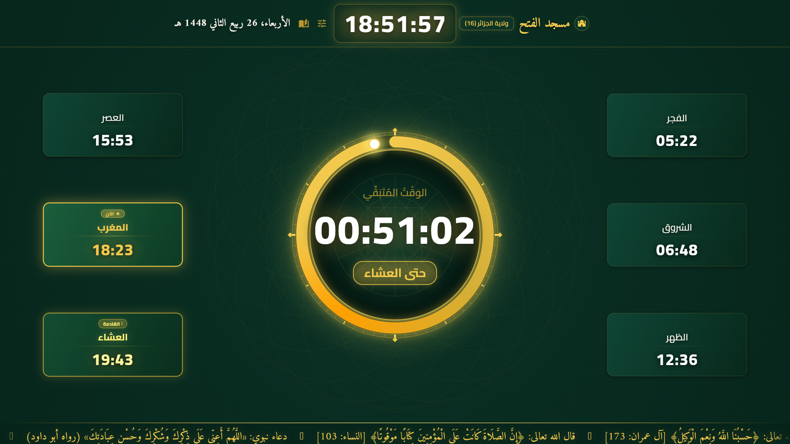
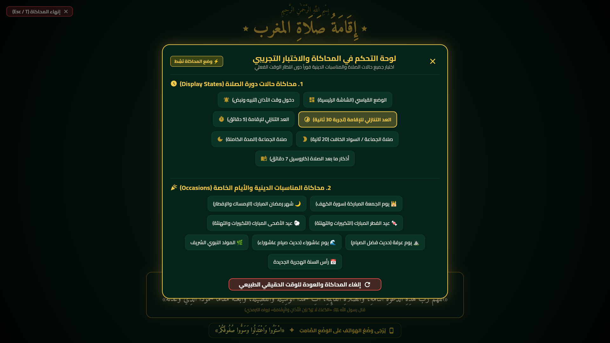

# منارة المساجد (Manarat Al-Masajid) 🕌
### Flutter Android TV Prayer Times & Announcement Display for Algerian Mosques

تطبيق شاشات المساجد (Android TV / Google TV) لعرض مواقيت الصلاة، العد التنازلي للإقامة، إطفاء الشاشة أثناء الصلاة، أذكار ما بعد الصلاة، والمناسبات الدينية لكافة الـ 58 ولاية جزائرية وفق تقويم وزارة الشؤون الدينية والأوقاف.

---

## 🌟 Features / المميزات

- **مواقيت الصلاة الرسمية للـ 58 ولاية:** حساب دقيق بحسب طريقة وزارة الشؤون الدينية والأوقاف الجزائرية (Method 19 - فجر 18°، عشاء 17°، مذهب مالكي).
- **التشغيل التلقائي عند انقطاع الكهرباء (Auto-start on Boot):** تشغيل التطبيق فور عودة التيار الكهربائي دون الحاجة لجهاز التحكم.
- **العد التنازلي للإقامة:** حلقة زمنية دائرية واضحة من مسافة 15 متر مع تنبيه صوتي وتغيير اللون عند اقتراب الإقامة.
- **إطفاء الشاشة أثناء الصلاة (Salat Blackout):** شاشة سوداء تماماً أو تنبيه صامت لغلق الهواتف لمنع تشتيت المصلين لمدة محددة.
- **أذكار ما بعد الصلاة:** عرض الأذكار المسنونة بعد الصلاة تلقائياً (الاستغفار، آية الكرسي، التسبيح).
- **محرك المناسبات الدينية والأدعية:** تنبيهات الجمعة (سورة الكهف والصلاة على النبي)، رمضان، الأعياد، ويوم عرفة.
- **شريط متحرك للإعلانات (Hadith & Announcement Marquee):** إمكانية إضافة إعلانات المسجد، دروس الأسبوع، وحساب التبرعات البريدي (CCP / RIP).
- **حماية الإعدادات برمز سري (4-Digit PIN):** منع التعديل غير المصرح به على الإعدادات.
- **العمل دون إنترنت (100% Offline):** كافة المواقيت والبيانات والأدعية والخطوط مخزنة محلياً.

---

## 📸 Screenshots / لقطات الشاشة

| لوحة التحكم الرئيسية | شاشة العد التنازلي للإقامة |
| :---: | :---: |
|  |  |

---

## 🚀 Installation & Deployment / التثبيت والنشر

### 1. Direct TV Install via Downloader App (Recommended / الأسهل)
1. قم بتثبيت تطبيق **Downloader by AFTVnews** من متجر Google Play على التلفاز / جهاز الـ TV Box.
2. افتح تطبيق Downloader وأدخل كود التحميل السريع في خانة البحث/الرابط:
   ```text
   [ ادخل كود التحميل السريع هنا ]
   ```
3. سيبدأ التحميل تلقائياً ثم اضغط **Install**.

### 2. Manual USB Install / التثبيت عبر فلاش ديسك
1. حمل ملف `app-release.apk` من قسم **Releases**.
2. انقله إلى فلاش ديسك (USB) بصيغة FAT32.
3. ركّب الفلاش في جهاز الـ Android TV وافتحه بأي مدير ملفات (File Manager) ثم ثبّت التطبيق.

---

## ⚙️ Configuration / ضبط الإعدادات

1. **الدخول للإعدادات:**
   - الضغط مطولاً على أي مكان في الشاشة بواسطة الفأرة/الريموت، أو
   - الضغط على أيقونة المسجد في الزاوية العلوية، أو
   - الضغط على زر القائمة (`Menu` / `Context Menu` / `F1`) في جهاز التحكم.
2. **الرمز السري الافتراضي:** `0000` (يُنصح بتغييره فوراً من قائمة الإعدادات).
3. **ضبط الولاية وفروق التوقيت:** اختر الولاية وقم بضبط الفوارق بالدقائق (إذا لزم الأمر) وفق تقويم المسجد المعتمد.

---

## 🛠️ Tech Stack

- **Framework:** Flutter (Android TV / Leanback landscape support)
- **Dart SDK:** >= 3.11.1
- **State Management:** Provider
- **Local Persistence:** SharedPreferences
- **Prayer Engine:** Adhan Dart + Custom Algerian astronomical & bundled timetable models
- **Typography:** Cairo & Amiri (Offline Bundled Fonts)

---

## 📄 License
Open source under the [MIT License](LICENSE).
