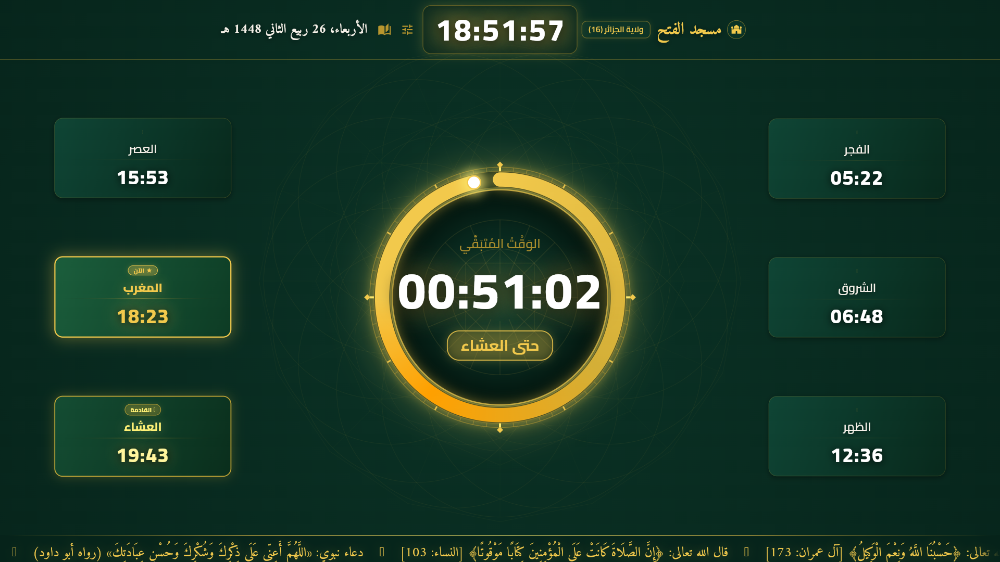
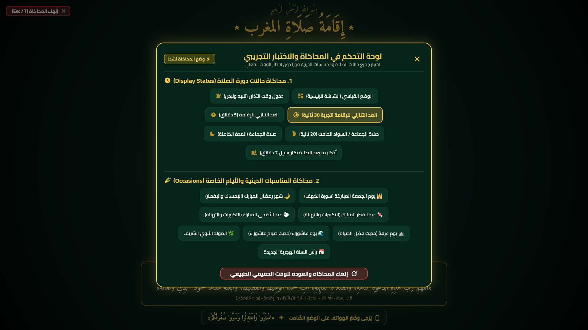

# منارة المساجد (Manarat Al-Masajid) 🕌
### Flutter Android TV Prayer Times & Announcement Display for Algerian Mosques

تطبيق شاشات المساجد الاحترافي لأجهزة التلفاز الذكية (**Android TV / Google TV / Android TV Boxes**) لعرض مواقيت الصلاة، العد التنازلي للإقامة، إطفاء الشاشة أثناء الصلاة، أذكار ما بعد الصلاة، المناسبات الدينية، وإدارة المسجد عن بعد لكافة **الـ 58 ولاية و1541 بلدية جزائرية** وفق تقويم وزارة الشؤون الدينية والأوقاف.

[](https://flutter.dev)
[](https://developer.android.com/tv)
[](LICENSE)
[]()

---

## 🌟 المميزات الرئيسية / Key Features

- **🇩🇿 تغطية شاملة لكافة بلديات الجزائر (1541 بلدية و58 ولاية):** حساب فلكي دقيق وفق طريقة وزارة الشؤون الدينية والأوقاف الجزائرية (فجر 18°، عشاء 17°، ومذهب مالكي لحساب العصر).
- **📱 لوحة تحكم وإدارة عن بعد عبر الويب والـ QR Code:**
  * سيرفر محلي مدمج (`shelf`) يتيح للإمام أو المؤذن التحكم الكامل بالإعدادات وكتابة الإعلانات عبر الهاتف أو الحاسوب من خلال شبكة الواي فاي المحلية للمسجد دون الحاجة للمس جهاز التلفاز.
  * نافذة اقتران سريعة بمسح رمز الاستجابة السريعة (QR Code) على الشاشة لفتح واجهة التحكم مباشرة على الهاتف (`http://[IP_التلفاز]:8080`).
- **🌙 مواقيت الإمساك والإفطار ومحاكاة المناسبات الدينية:**
  * حساب وقت الإمساك الرسمي (قبل أذان الفجر بـ 10 دقائق) ووقت الإفطار (متطابق مع المغرب).
  * محاكاة ديناميكية حية للمناسبات الكبرى (شهر رمضان المبارك، ليلة القدر، عيدي الفطر والأضحى، يوم عرفة، وعاشوراء).
- **🕌 دورة حياة صلاة الجمعة (Jumu'ah Lifecycle):**
  * تنبيهات خاصة بيوم الجمعة (قراءة سورة الكهف، الصلاة على النبي ﷺ).
  * شاشة إطفاء وصمت أثناء خطبة وصلاة الجمعة ودعم الأذانين.
- **⏱️ عد تنازلي دائري واضح للإقامة:** حلقة زمنية دائرية قياسية تُقرأ بوضوح فائق من مسافة تزيد عن 15 متراً مع تنبيه صوتي وتدرج لوني عند اقتراب الإقامة.
- **🔌 التشغيل التلقائي فور عودة التيار (Auto-start on Boot):** تشغيل التطبيق ذاتياً فور استعادة الكهرباء دون الحاجة لاستخدام الريموت كنترول.
- **📴 إطفاء الشاشة أثناء الصلاة (Salat Blackout):** شاشة سوداء مع تنبيه صامت لغلق الهواتف لمنع تشتيت المصلين طوال فترة الصلاة.
- **📿 أذكار ما بعد الصلاة:** استعراض تلقائي للأذكار المأثورة بعد الصلوات الخمس (الاستغفار، آية الكرسي، والتسبيحات).
- **📢 شريط متحرك للإعلانات والدروس (Marquee Ticker):** إمكانية إدخال إعلانات المسجد، دروس الأسبوع، وأرقام الحسابات البريدية للتبرعات (CCP / RIP).
- **🖥️ توافق تلقائي مع كافة دقات الشاشات (Dynamic Multi-Scale):** تناسب كامل مع شاشات HD (720p)، Full HD (1080p)، وشاشات 4K Ultra HD.
- **🔒 حماية برمز سري (4-Digit PIN):** حماية قائمة الإعدادات برمز سري مخصص لمنع العبث.
- **⚡ عمل مستقل 100% دون إنترنت:** جميع الإحداثيات، الحسابات الفلكية، الأدعية، والخطوط مخزنة ومثبتة محلياً داخل التطبيق.

---

## 📸 لقطات الشاشة / Screenshots

| لوحة التحكم الرئيسية (Main Dashboard) | شاشة العد التنازلي للإقامة (Iqamah Countdown) |
| :---: | :---: |
|  |  |

---

## 🚀 التثبيت والتحميل / Installation & Releases

### رابط التحميل المباشر للإصدار المستقر (APK)
- **تحميل مباشر (Direct Download):** [app-release.apk (v1.2.1)](https://github.com/azizou-houssem-eddine/mosque_display/releases/download/v1.0.0/app-release.apk)
- **صفحة الإصدارات الرسمية:** [GitHub Releases](https://github.com/azizou-houssem-eddine/mosque_display/releases)

---

### الطريقة الأولى: التثبيت السريع عبر تطبيق Downloader (الأسهل للشاشات)
1. قم بتثبيت تطبيق **Downloader by AFTVnews** من متجر Google Play على التلفاز أو جهاز الـ TV Box.
2. افتح تطبيق Downloader وأدخل الرابط المباشر:
   ```text
   https://github.com/azizou-houssem-eddine/mosque_display/releases/download/v1.0.0/app-release.apk
   ```
3. سيبدأ التحميل تلقائياً ثم اضغط **Install**.

---

### الطريقة الثانية: التثبيت اليدوي عبر فلاش ديسك (USB)
1. حمل ملف `app-release.apk` من رابط التحميل أعلاه.
2. انقل الملف إلى فلاش ديسك (USB) مفرمت بنظام **FAT32**.
3. وصّل الفلاش في منفذ التلفاز، افتحه بواسطة أي مدير ملفات (مثل *File Commander* أو *FX File Explorer*)، ثم ثبّت التطبيق.

---

### ⚠️ استكشاف أخطاء التثبيت ("App not installed")
إذا ظهرت لك رسالة الخطأ **"App not installed"** على أجهزة TCL أو Android TV، اتبع الخطوات التالية:
1. **إلغاء تثبيت النسخة القديمة أولاً:** إذا كانت هناك نسخة مثبتة سابقاً على التلفاز، يجب إلغاء تثبيتها تماماً:
   * **الإعدادات (Settings)** ← **التطبيقات (Apps)** ← **عرض جميع التطبيقات** ← **منارة المساجد** ← **إلغاء التثبيت (Uninstall)**.
2. **تفعيل خيار التثبيت من مصادر غير معروفة:**
   * **الإعدادات** ← **الأمان والقيود** أو **التطبيقات الخاصة** ← **تثبيت التطبيقات المجهولة (Install unknown apps)** ← تفعيل الإذن لمدير الملفات أو تطبيق Downloader.
3. **التأكد من توفر مساحة تخزين:** التحقق من وجود 150 ميغابايت على الأقل شاغرة في الذاكرة الداخلية للتلفاز.

---

## ⚙️ ضبط الإعدادات والتحكم / Configuration

### 1. الدخول لقائمة الإعدادات على التلفاز
- **بجهاز التحكم (الريموت):** الضغط على زر القائمة (`Menu` / `Context Menu` / `F1` أو `D-pad Center` على أيقونة الإعدادات).
- **بالفأرة / الفأرة الهوائية:** الضغط مطولاً على أي نقطة فارغة في الشاشة أو النقر على أيقونة المسجد في الزاوية العلوية.
- **الرمز السري الافتراضي:** `0000` (يُرجى تغييره فوراً بعد أول تشغيل).

### 2. التحكم عن بعد عبر السيرفر المحلي المدمج (Remote Admin Web Panel)
1. اضغط على خيار **"ربط الإدارة عن بعد"** من قائمة الإعدادات على الشاشة.
2. امسح رمز الـ **QR Code** الظاهر بواسطة كاميرا الهاتف الذكي (يشترط اتصال الهاتف والتلفاز بنفس شبكة الواي فاي).
3. يمكنك أيضاً كتابة الرابط مباشرة في متصفح الهاتف أو الكمبيوتر:
   ```text
   http://[عنوان_IP_التلفاز]:8080
   ```
4. سجل الدخول برمز الـ PIN، ويمكنك فوراً:
   - تعديل أوقات الإقامة لكل صلاة بدقة.
   - ضبط فروق الدقائق للمواقيت حسب خصوصية المسجد.
   - كتابة وتحديث شريط الإعلانات وتعديل نص التبرعات فوراً.
   - تشغيل محاكاة واختبار الأذان والأعياد والجمعة.

---

## 🛠️ البنية التقنية / Tech Stack

- **Framework:** Flutter (Android TV Landscape Leanback Support)
- **Dart SDK:** `>= 3.11.1`
- **State Management:** Provider (`DisplayProvider`)
- **Local Embedded Server:** Shelf + Shelf Router (`RemoteAdminServer` on port 8080)
- **Persistence:** SharedPreferences (`SettingsRepository`)
- **Astronomical Prayer Engine:** Adhan Dart + Custom Algerian calculation rules (Method 19)
- **Hijri Calendar:** Umm al-Qura + Manual Calibration Offset (`HijriCalculator`)
- **Hardware Integration:** Wakelock Plus & Native Android BroadcastReceiver (`BootReceiver`)
- **Offline Typography:** Cairo & Amiri Arabic Fonts

---

## 📱 التوافق مع أنظمة أندرويد (Android Compatibility)

| المعيار | القيمة | الوصف |
| :--- | :--- | :--- |
| **Minimum SDK** | `24` | يدعم الأجهزة من **Android 7.0 (Nougat)** فما فوق |
| **Target SDK** | `34` | متوافق مع معايير **Android 14** المستقرة |
| **Signing Schemes** | `v1 (JAR) + v2` | توقيع مزدوج يضمن التثبيت السلس على شاشات TCL وكافة أجهزة Android TV |
| **Architectures** | `armeabi-v7a`, `arm64-v8a`, `x86_64` | حزمة شاملة (Fat APK) تغطي جميع معالجات التلفاز الذكية |

---

## 📄 الترخيص / License
هذا المشروع مفتوح المصدر ومتاح وقفاً لوجه الله تعالى ولخدمة مساجد المسلمين تحت رخصة [MIT License](LICENSE).
